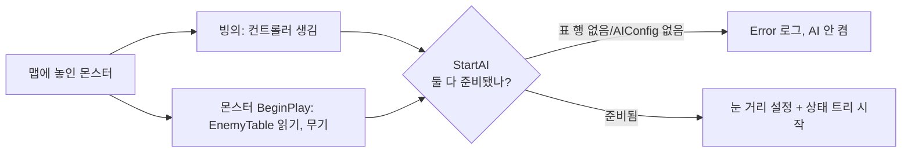
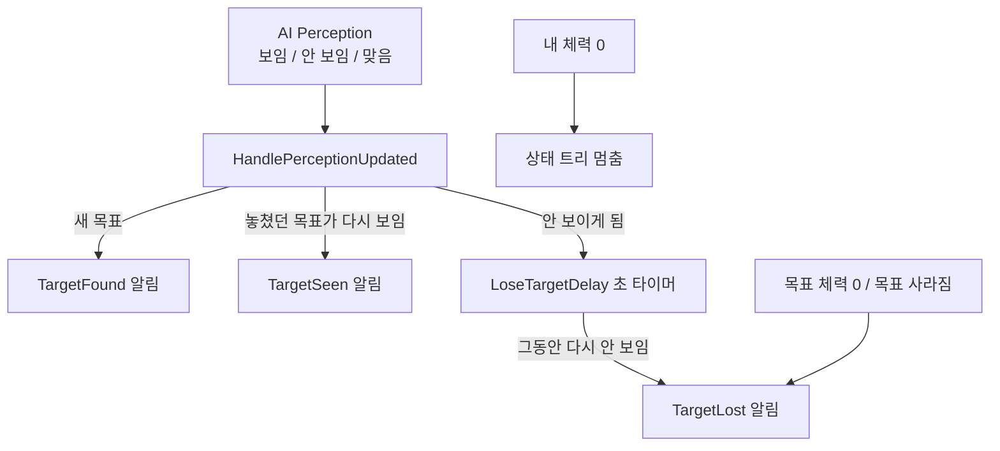
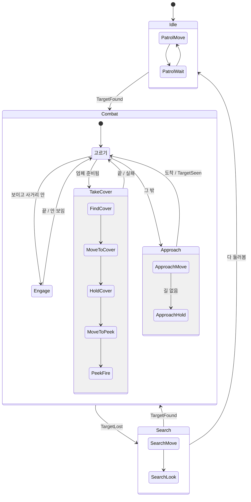

# 몬스터 AI

서버에서만 돈다. 클라이언트는 몬스터의 움직임·조준 각도·사격 결과만 복제로 받는다.

## 누가 무엇을 하나

| 무엇 | 어디 | 고치는 곳 |
|---|---|---|
| 무엇을 할지 고르기(순찰/전투/수색) | `ST_Enemy` 상태 트리 에셋 | 에디터(상태 트리 편집기) |
| 엄폐 후보 고르기 | `EQS_FindCover` EQS 에셋 | 에디터(EQS 편집기) |
| 행동 숫자(시야 각도, 포기 시간, 시간 제한…) | `DA_EnemyAI_Rifle` (`UEnemyAIConfig`) | 에디터 |
| 몬스터 종류별 숫자(감지 거리, 사거리, 체력…) | `EnemyTable` | 에디터 |
| 어떤 DA 를 쓸지 | `CBP_CustomEnemyCharacter` 의 AIConfig 칸 | 에디터 |
| 감지·목표 정하기·이동·사격 | `CustomEnemyAIController` | C++ |
| 엄폐 자리·옆 쏠 자리 확인 | `EnemyCoverFinderComponent` (컨트롤러에 붙음) | C++ |
| 상태 트리 작업 조각 | `EnemyStateTreeNodes` | C++ |

에셋이 없을 때 처음 한 번 만들기:
`UnrealEditor-Cmd.exe ProjectPG.uproject -run=PGBuildEnemyAI -unattended -nosplash`
(이미 있으면 건드리지 않는다. 처음 모양으로 되돌릴 때만 `-Force`.)

## 시작

## 감지 → 상태 트리 알림

## 상태 트리 ST_Enemy

## 기다리는 일과 시간 제한

| 기다리는 것 | 제한 | 넘으면 |
|---|---|---|
| 이동 하나 | 예상 시간(길 길이 ÷ 속도) × `MoveTimeoutScale` + `MoveTimeoutSlack` | Error 로그, 이동 멈춤, 작업 실패 → 전투 다시 고르기 |
| 엄폐 EQS 답 | `CoverQueryTimeout` | Error 로그, EQS 취소, 작업 실패 |
| 안 보이는 목표 | `LoseTargetDelay` | 목표 포기(TargetLost) → 수색 |

## 멀티 시험

시험 맵 `L_EnemyAITest`(바닥·벽·시작 자리 2개·몬스터 1마리, 게임모드 `BP_EnemyAITestGameMode`)에서 데디 서버 + 클라 2명.
맵은 `Tools/level/build_enemy_ai_test_level.py` 로 만든다(실행법은 파일 맨 위).
서버 로그 `[EnemyAI]` 줄에 "목표 정함 → 엄폐 자리 찾기 → … → 사격 → 목표 포기 → 수색" 이 차례로 나오면 정상.
일반 맵(GameModePG 계열)은 MapBuilder 가 플레이어를 몬스터와 먼 시작 구역에 세워서 전투 확인용으론 안 맞는다.

## 매 프레임 도는 것

- 없음(컨트롤러 Tick 꺼짐). 상태 트리는 기다리기·사격 작업이 예약한 시각에만 깨어난다.
- 예외: 몬스터 몸의 조준 각도 복제(`CustomEnemyCharacter::Tick`)는 **목표가 있을 때만** 매 프레임. 고개 돌리는 애니메이션이 부드러워야 해서.
