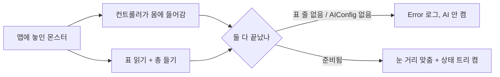
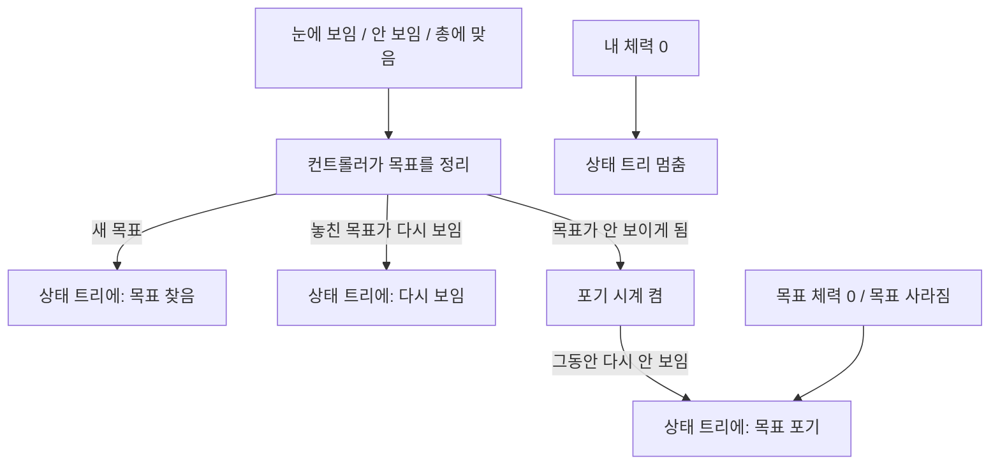
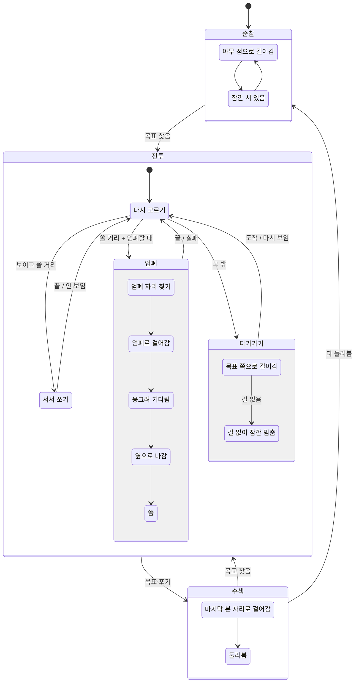

# 몬스터 AI

서버에서만 돈다. 클라이언트는 몬스터의 움직임·조준 각도·사격 결과만 복제로 받는다.

## 누가 무엇을 하나

| 무엇 | 어디 | 고치는 곳 |
|---|---|---|
| 무엇을 할지 고르기(순찰/전투/수색) | `ST_Enemy` 상태 트리 에셋 | 에디터(상태 트리 편집기) |
| 엄폐 후보 고르기 | `EQS_FindCover` EQS 에셋 | 에디터(EQS 편집기) |
| 행동 숫자(시야 각도, 포기 시간, 시간 제한…) | `DA_EnemyAI_Rifle` (`UEnemyAIConfig`) | 에디터 |
| 몬스터 종류별 숫자(감지 거리, 사거리, 체력…) | `EnemyTable` | 에디터 |
| 어떤 DA 를 쓸지 | `CBP_CustomEnemyCharacter` 의 AIConfig 칸 | 에디터 |
| 감지·목표 정하기·이동·사격 | `CustomEnemyAIController` | C++ |
| 엄폐 자리·옆 쏠 자리 확인 | `EnemyCoverFinderComponent` (컨트롤러에 붙음) | C++ |
| 상태 트리 작업 조각 | `EnemyStateTreeNodes` | C++ |

에셋이 없을 때 처음 한 번 만들기:
`UnrealEditor-Cmd.exe ProjectPG.uproject -run=PGBuildEnemyAI -unattended -nosplash`
(이미 있으면 건드리지 않는다. 처음 모양으로 되돌릴 때만 `-Force`.)

## 한눈에: 몬스터 한 마리의 하루

1. 맵에 놓인 몬스터가 깨어난다 → 표(EnemyTable)에서 체력·감지 거리를 읽고 총을 든다.
2. 할 일이 없으면 처음 자리 둘레를 걸어 다니고, 가끔 멈춰 서 있는다(순찰).
3. 플레이어가 눈에 들어오거나 총에 맞으면 → 그 사람을 목표로 정하고 싸우기 시작한다(전투).
4. 싸우는 동안엔 상황을 보고 셋 중 하나를 고른다.
   - 쏠 수 있는 거리고 엄폐할 때가 됐으면 → 벽 뒤에 숨었다가 옆으로 나와 쏜다.
   - 보이고 쏠 수 있는 거리면 → 그 자리에서 쏜다.
   - 그 밖(멀거나 안 보임) → 다가간다.
5. 목표가 오래 안 보이거나 죽으면 → 포기하고, 마지막으로 본 자리에 가서 둘러본다(수색).
6. 수색 중에 또 보이면 다시 전투, 아무도 없으면 순찰로 돌아간다.

## 깨어날 때

말로 된 흐름:
- 몬스터가 맵에 놓임 → 컨트롤러가 몸에 들어감(빙의)
- 몬스터 몸이 표를 읽고 총을 듦(BeginPlay)
- 두 가지가 다 끝났을 때만 → 눈의 감지 거리를 맞추고 상태 트리를 켬
- 표에 그 몬스터 줄이 없거나, BP 에 AIConfig 가 비어 있으면 → Error 로그를 남기고 AI 를 켜지 않음

## 눈에 보이거나 맞았을 때

말로 된 흐름:
- 플레이어가 시야에 들어옴, 시야에서 빠짐, 또는 몬스터가 총에 맞음 → 컨트롤러가 알게 됨
- 목표가 없던 중이면 → 그 사람을 목표로 정하고 상태 트리에 "목표 찾음"
- 놓쳤던 목표가 다시 보이면 → "다시 보임" (다가가던 중이면 바로 쏠지 다시 고름)
- 목표가 시야에서 빠지면 → 시계를 켬(LoseTargetDelay 초). 그동안 다시 안 보이면 → "목표 포기"
- 목표의 체력이 0 이 되거나 목표가 사라지면 → 바로 "목표 포기"
- 몬스터 자신의 체력이 0 이 되면 → 상태 트리를 멈춤

## 상태 트리 ST_Enemy (무엇을 할지 고르기)

말로 된 흐름:
- 순찰: 아무 점으로 걸어감 → 잠깐 서 있음 → 다시 걸어감 (반복)
- "목표 찾음" → 전투
- 전투: 위에서부터 조건이 맞는 첫 번째를 고름. 하나가 끝나거나 실패하면 다시 고름.
  - 엄폐: 엄폐 자리 찾기 → 엄폐로 걸어감 → 웅크려 기다림 → 옆 쏠 자리로 나감 → 쏨
  - 서서 쏘기: 정해진 시간 동안 쏨. 목표가 안 보이게 되면 중간에 끝.
  - 다가가기: 목표 쪽으로 걸어감. 길이 없으면 잠깐 멈춰 있음. 다시 보이면 바로 다시 고름.
- "목표 포기" → 수색: 마지막으로 본 자리로 걸어감 → 둘러봄 → 순찰
- 수색 중 "목표 찾음" → 전투

상태 트리 에셋 안의 실제 상태 이름: Idle(PatrolMove, PatrolWait) · Combat(TakeCover: FindCover, MoveToCover, HoldCover, MoveToPeek, PeekFire / Engage / Approach: ApproachMove, ApproachHold) · Search(SearchMove, SearchLook).

## 기다리는 일과 시간 제한

| 기다리는 것 | 제한 | 넘으면 |
|---|---|---|
| 이동 하나 | 예상 시간(길 길이 ÷ 속도) × `MoveTimeoutScale` + `MoveTimeoutSlack` | Error 로그, 이동 멈춤, 작업 실패 → 전투 다시 고르기 |
| 엄폐 EQS 답 | `CoverQueryTimeout` | Error 로그, EQS 취소, 작업 실패 |
| 안 보이는 목표 | `LoseTargetDelay` | 목표 포기(TargetLost) → 수색 |

## 멀티 시험

시험 맵 `L_EnemyAITest`(바닥·벽·시작 자리 2개·몬스터 1마리, 게임모드 `BP_EnemyAITestGameMode`)에서 데디 서버 + 클라 2명.
맵은 `Tools/level/build_enemy_ai_test_level.py` 로 만든다(실행법은 파일 맨 위).
서버 로그 `[EnemyAI]` 줄에 "목표 정함 → 엄폐 자리 찾기 → … → 사격 → 목표 포기 → 수색" 이 차례로 나오면 정상.
일반 맵(GameModePG 계열)은 MapBuilder 가 플레이어를 몬스터와 먼 시작 구역에 세워서 전투 확인용으론 안 맞는다.

## 매 프레임 도는 것

- 없음(컨트롤러 Tick 꺼짐). 상태 트리는 기다리기·사격 작업이 예약한 시각에만 깨어난다.
- 예외: 몬스터 몸의 조준 각도 복제(`CustomEnemyCharacter::Tick`)는 **목표가 있을 때만** 매 프레임. 고개 돌리는 애니메이션이 부드러워야 해서.
