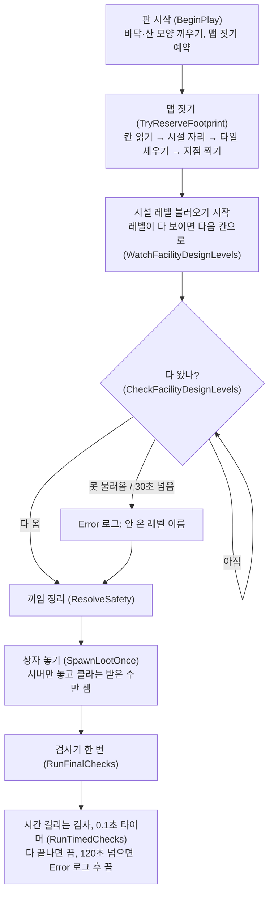
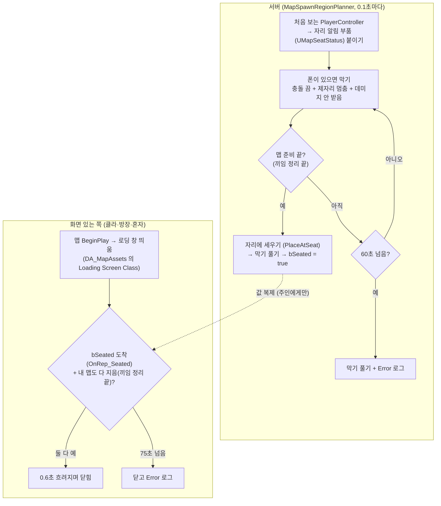

# MapBuilder

논리 칸(AMapTile) 격자를 보고 실제 맵(타일·시설·상자)을 세운다. 본체는 `../MapBuilder.cpp`, 이 폴더는 일꾼들.

## 0.1초마다 확인하는 것 (Tick) 과 이유

1. **새로 들어온 사람을 시작 구역에 세우기** (서버만)
   - 왜 매번 확인: 한 번에 안 끝날 때가 있다. 캐릭터가 아직 없거나 세울 자리가 없으면 2초 뒤 다시, 캐릭터가 바뀌면 같은 자리에 다시.
   - 나중에 바꿀 것: 매번 확인 대신 "누가 들어왔을 때 / 캐릭터가 생겼을 때 / 2초 뒤 다시"에만 세우기. 바꾸면 서버+2명으로 다시 시험해야 해서 이번엔 그대로 둠.
   - 부담: 기다리는 사람이 없으면 확인 한 번 하고 바로 끝남.
2. **내 캐릭터 주변 60 m 안에서 몬스터 길찾기가 벽을 피하도록 새로 고치기**
   - 왜 매번 확인: 캐릭터는 계속 움직이는데, "40 m 칸을 넘었다"고 엔진이 따로 알려 주지 않는다.
   - 부담: 칸이 바뀔 때만 실제로 새로 고친다. 평소엔 칸 비교 한 번.

## 로딩 창과 시작 무적

접속 직후 폰은 아무 데나 생기고, 맵이 다 지어져 시작 구역 자리에 설 때까지 시간이 걸린다. 그 사이 몬스터에게 죽지 않게 막고, 화면은 로딩 창으로 가린다.

- 충돌까지 끄는 이유: 팀원 캐릭터의 피해 처리(`Hit`)는 `CanBeDamaged` 를 안 본다. 충돌을 끄면 총알 선·근접 공격이 몸에 안 닿는다. 캐릭터 파일은 안 고친다.
- "섰다" 를 값(`bSeated`)으로 보내는 이유: 한 번 보내는 함수는 부품이 클라에 생기기 전에 오면 사라질 수 있다. 값은 늦게라도 온다.
- 로딩 창 코드는 ProjectTest2 의 `PGLoadingScreenSubsystem` 에서 가져왔다(시작 로고·안내 문구 부분은 뺐다). WBP 부모 이름이 그대로라 `DefaultEngine.ini` 의 `ProjectPGTest2 → ProjectPG` 줄로 이어진다.

흐름이 헷갈리면 Rider 의 Find Usages 로 함수를 거꾸로 따라가면 된다.

## 고친 뒤 확인 (같은 시드 시험)

`powershell -ExecutionPolicy Bypass -File Tools\test\MapSeedCheck.ps1` → 빌드하고 서버+클라를 띄워 상자 수·지문을 `Tools\test\MapSeedExpected.txt` 와 비교한다(약 4분). 맵을 일부러 바꿨으면 기대값 파일을 고친다.
