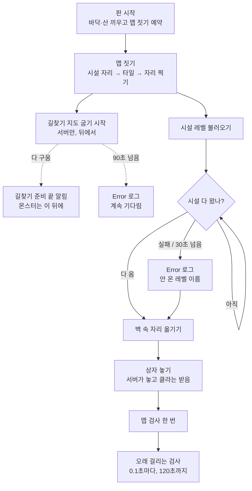

# MapBuilder

논리 칸(AMapTile) 격자를 보고 실제 맵(타일·시설·상자)을 세운다. 본체는 `../MapBuilder.cpp`, 이 폴더는 일꾼들.

말로 된 흐름 (판이 시작되면 실제로 일어나는 순서):

1. 판이 시작되면 → 맵이 바닥·산 모양을 끼우고 맵 짓기를 예약한다 (`BeginPlay`)
2. 칸 정보가 오면 → 맵이 시설 자리를 고르고, 타일을 세우고, 시작·상자·몬스터 자리를 찍는다 (`TryReserveFootprint`)
3. 그와 동시에, 서버에서만 → 길찾기 담당이 맵 크기 길찾기 영역을 넣고, 몬스터 길찾기 지도를 게임을 멈추지 않고 뒤에서 굽기 시작한다 (`UMapNavigationBuilder::StartBuild`)
   - 다 구우면 → 엔진이 알려 주고, 맵이 "길찾기 준비 끝" 을 한 번 알린다 (`OnNavigationReady`, 로그 `Navigation build finished: seconds=`). 몬스터를 내보내거나 움직이는 쪽은 이 뒤에 해야 한다.
   - 90초(`DA_MapAssets` 의 기다리는 시간)가 지나도 안 끝나면 → 남은 굽기 일 수를 Error 로그로 남기고, 계속 기다린다(늦게 끝나면 로그에 `late=true`)
4. 타일을 세운 뒤 → 맵이 창고 같은 시설 레벨을 불러오고, 레벨이 하나 다 보일 때마다 전부 왔는지 센다 (`WatchFacilityDesignLevels` → `CheckFacilityDesignLevels`)
   - 못 불러오거나 30초가 지나면 → 안 온 레벨 이름을 Error 로그로 남기고 다음으로 넘어간다
5. 시설이 다 오면 → 벽 속에 박힌 자리를 옮긴다 (`ResolveSafety`)
6. 그다음 → 서버가 상자 자리마다 상자를 놓는다. 들어온 사람은 서버가 놓은 상자를 받아서 센다 (`SpawnLootOnce`)
7. 마지막으로 → 검사기가 맵을 한 번 검사하고 (`RunFinalChecks`), 시간이 걸리는 검사는 0.1초마다 이어서 한다. 다 끝나거나 120초가 지나면 멈춘다 (`RunTimedChecks`)

길찾기 지도가 게임 중에 구워지려면 `Config/DefaultEngine.ini` 의 `RuntimeGeneration=Dynamic` 한 줄이 있어야 한다(없으면 영역을 넣어도 지도가 안 생김). 영역 높이·기다리는 시간은 `DA_MapAssets` 의 "길찾기" 칸.

## 0.1초마다 확인하는 것 (Tick) 과 이유

1. **새로 들어온 사람을 시작 구역에 세우기** (서버만)
   - 왜 매번 확인: 한 번에 안 끝날 때가 있다. 캐릭터가 아직 없거나 세울 자리가 없으면 2초 뒤 다시, 캐릭터가 바뀌면 같은 자리에 다시.
   - 나중에 바꿀 것: 매번 확인 대신 "누가 들어왔을 때 / 캐릭터가 생겼을 때 / 2초 뒤 다시"에만 세우기. 바꾸면 서버+2명으로 다시 시험해야 해서 이번엔 그대로 둠.
   - 부담: 기다리는 사람이 없으면 확인 한 번 하고 바로 끝남.
2. **내 캐릭터 주변 60 m 안에서 몬스터 길찾기가 벽을 피하도록 새로 고치기**
   - 왜 매번 확인: 캐릭터는 계속 움직이는데, "40 m 칸을 넘었다"고 엔진이 따로 알려 주지 않는다.
   - 부담: 칸이 바뀔 때만 실제로 새로 고친다. 평소엔 칸 비교 한 번.

흐름이 헷갈리면 Rider 의 Find Usages 로 함수를 거꾸로 따라가면 된다.

## 고친 뒤 확인 (같은 시드 시험)

`powershell -ExecutionPolicy Bypass -File Tools\test\MapSeedCheck.ps1` → 빌드하고 서버+클라를 띄워 상자 수·지문을 `Tools\test\MapSeedExpected.txt` 와 비교한다(약 4분). 맵을 일부러 바꿨으면 기대값 파일을 고친다.
