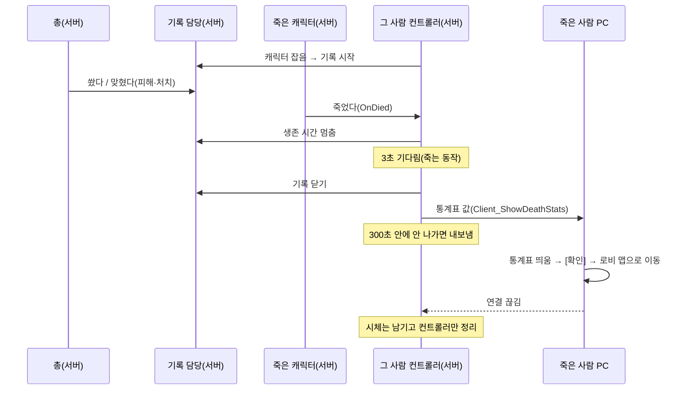

# 게임모드·플레이어 컨트롤러

로비(`GameMode_InLobby`, `PlayerController_InLobby`)와 게임 판(`GameMode_InGame`, `PlayerController_InGame`)의
흐름을 적는다. 코드 주석에는 그 줄 이야기만 있고, 전체 순서는 여기서 본다.

## 죽으면 통계표 → [확인] → 그 사람만 로비로 (2026-10-18, 통계표 2026-10-19)

죽은 사람은 죽는 동작을 몇 초 본 뒤 이번 판 통계표를 보고, [확인]을 누르면 혼자 로비로 나간다.
살아 있는 사람 게임은 그대로 이어지고, 시체는 그 자리에 남는다.

말로 된 흐름:

1. 판 시작: 서버에서 플레이어 컨트롤러(`PlayerController_InGame`)가 캐릭터를 잡는다 → 기록 담당(`UPGRaidStatsSubsystem`)이 이 사람 기록을 새로 시작한다(생존 시간 시계 켬).
2. 판 도중: 누가 총을 쏠 때마다 총(`AFirearmEquipment::Fire`, 서버)이 기록 담당에 알린다.
   - 플레이어가 한 발 쏨 → 그 사람 "발사" +1
   - 플레이어 총알이 무언가를 맞힘 → "명중" +1, 실제로 깎인 체력만큼 "가한 피해", 그 총알로 죽었으면 "처치" +1
   - 누군가의 총알이 플레이어를 맞힘 → 그 사람 "받은 피해", 맞힌 쪽 이름을 "사망 원인" 으로 적어 둠(몬스터면 "몬스터")
   - 몬스터가 쏜 것은 몬스터 쪽 기록이 없으니 무시(플레이어가 맞은 쪽만 셈)
3. 서버: 플레이어 체력이 0이 된다 → 캐릭터가 죽는다(`ACustomCharacter::Die`) → "죽었다" 신호(`OnDied`)를 울린다.
   - 클라이언트는 따로 "죽음" 값을 복제로 받아 쓰러지는 동작을 튼다(원래 있던 것).
   - 몬스터도 같은 캐릭터라 신호는 울리지만, 받는 컨트롤러가 없어 아무 일도 없다.
4. 서버: 그 사람 컨트롤러가 신호를 받는다 → 생존 시간을 여기서 멈춘다 → 3초 타이머를 건다(죽는 동작 볼 시간).
   - 기록은 아직 닫지 않는다. 죽인 총알의 피해·사망 원인은 "죽었다" 신호 다음에 적히기 때문.
5. 서버: 3초 뒤 → 기록을 닫고 그 사람 PC 에게만 통계표 값(`Client_ShowDeathStats`)을 보낸다 → 300초짜리 "안 나가면 내보내기" 타이머도 건다.
6. 죽은 사람 PC: 가둬 둔 마우스를 풀고, 열려 있던 가방 창을 닫고, 통계표(`WBP_DeathStats`)를 화면 맨 위에 띄운다.
   - 통계표 WBP 를 못 찾으면(설정 비었음, 패키지에 안 담김) → Error 로그를 남기고 바로 로비로 간다(죽은 화면에 갇히지 않게).
7. 죽은 사람이 [확인](또는 Enter·Space)을 누른다 → 게임 시작 맵(로비, `DefaultEngine.ini` 의 `GameDefaultMap`)으로 혼자 이동한다.
   → 로비가 열리면 원래처럼 웹 서버에서 짐을 다시 받는다.
8. 서버: 그 사람 연결이 끊긴다 → 컨트롤러를 정리한다. 이때 캐릭터가 죽어 있으면 지우지 않고 손만 뗀다 → 시체가 남는다.
   - 살아 있는데 나간 사람(창 닫음 등)은 원래대로 캐릭터를 지운다.
   - 300초가 지나도 [확인]을 안 눌러 연결이 남아 있으면 → 서버가 Error 로그를 남기고 내보낸다(쫓겨난 클라도 엔진이 로비로 보낸다).
9. 다른 플레이어: 아무 영향 없이 계속 진행한다.

통계표에 나오는 것(`FPGRaidStats`): 생존 시간, 처치, 발사, 명중, 가한 피해, 받은 피해, 사망 원인.

통계표 모양 바꾸기: `Content/PG/Blueprint/UI/DeathStats/WBP_DeathStats` 를 에디터에서 고친다.
- C++ 부모 `UPGDeathStatsWidget` 은 이름이 맞는 칸에 숫자만 넣는다: `SurvivalTimeText`, `KillsText`, `ShotsFiredText`, `HitsText`, `DamageDealtText`, `DamageTakenText`, `KilledByText`, 버튼 `ConfirmButton`. 칸이 없어도 안 터진다.
- 숫자가 다 들어간 뒤 `OnStatsShown` 이벤트가 불린다 → 나타나는 애니메이션·소리는 WBP 그래프에서.
- 처음 모양은 `Tools/wbp/build_death_stats.py` 로 만들었다(이미 있으면 칸 이름만 맞추고 손댄 모양은 그대로 둠).

숫자 바꾸기: `Config/DefaultGame.ini` 의 `[/Script/ProjectPG.PlayerController_InGame]`
- `SecondsBeforeDeathStats` 죽고 나서 통계표가 뜨기까지 초 (기본 3)
- `SecondsBeforeForceKick` 통계표를 보낸 뒤 서버가 내보내기까지 초 (기본 300)
- `DeathStatsWidgetClass` 통계표 WBP. 그 폴더는 같은 파일 `DirectoriesToAlwaysCook` 에 있어야 패키지에 담긴다.

아직 없는 것(이번 범위 밖):
- 웹 서버에 "이 사람 탈락·기록" 알리기 → 웹 서버 쪽 메시지가 생기면 5번에서 보낸다.
- 죽은 사람 장비를 잃는 규칙·시체 상자 → 지금은 게임 중 바뀐 짐이 로비로 안 넘어가고, 로비는 웹 서버 짐을 다시 받는다.
- 관전 화면, 탈출 성공 때의 결과표.

시험: `Tools/test/EnemyVoiceTileTest.ps1 -EnemyPlayers 1` (몬스터를 첫 사람 둘레에만 놓아 그 사람만 죽게 함).
서버 로그 `[DeathToLobby]` 의 "Sending stats" 줄, 죽은 클라 로그 "Death stats shown" → [확인] 뒤 `LobbyLevel` 로 확인.
