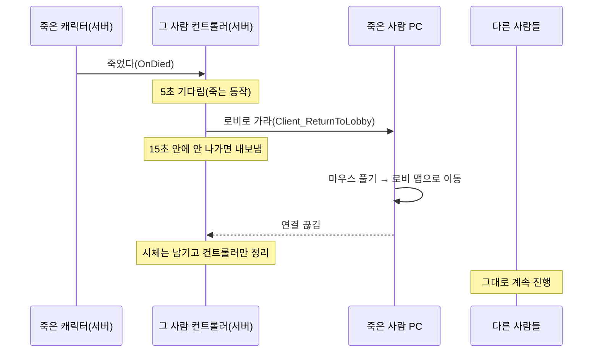

# 게임모드·플레이어 컨트롤러

로비(`GameMode_InLobby`, `PlayerController_InLobby`)와 게임 판(`GameMode_InGame`, `PlayerController_InGame`)의
흐름을 적는다. 코드 주석에는 그 줄 이야기만 있고, 전체 순서는 여기서 본다.

## 죽으면 그 사람만 로비로 (2026-10-18)

죽은 사람은 죽는 동작을 몇 초 본 뒤 혼자 로비로 나가고, 살아 있는 사람 게임은 그대로 이어진다.
시체는 그 자리에 남는다.

말로 된 흐름:

1. 서버: 플레이어 체력이 0이 된다 → 캐릭터가 죽는다(`ACustomCharacter::Die`) → "죽었다" 신호(`OnDied`)를 울린다.
   - 클라이언트는 따로 "죽음" 값을 복제로 받아 쓰러지는 동작을 튼다(원래 있던 것).
   - 몬스터도 같은 캐릭터라 신호는 울리지만, 받는 컨트롤러가 없어 아무 일도 없다.
2. 서버: 그 플레이어의 컨트롤러(`PlayerController_InGame`)가 신호를 받는다 → 5초 타이머를 건다(죽는 동작 볼 시간).
3. 서버: 5초 뒤 → 그 사람 PC 에게만 "로비로 가라"(`Client_ReturnToLobby`)를 보낸다 → 15초짜리 "안 나가면 내보내기" 타이머도 건다.
4. 죽은 사람 PC: 가둬 둔 마우스를 풀고 커서를 보인 뒤 → 게임 시작 맵(로비, `DefaultEngine.ini` 의 `GameDefaultMap`)으로 혼자 이동한다.
   → 로비가 열리면 원래처럼 웹 서버에서 짐을 다시 받는다.
5. 서버: 그 사람 연결이 끊긴다 → 컨트롤러를 정리한다. 이때 캐릭터가 죽어 있으면 지우지 않고 손만 뗀다 → 시체가 남는다.
   - 살아 있는데 나간 사람(창 닫음 등)은 원래대로 캐릭터를 지운다.
   - 15초가 지나도 연결이 남아 있으면 → 서버가 Error 로그를 남기고 내보낸다(쫓겨난 클라도 엔진이 로비로 보낸다).
6. 다른 플레이어: 아무 영향 없이 계속 진행한다.

숫자 바꾸기: `Config/DefaultGame.ini` 의 `[/Script/ProjectPG.PlayerController_InGame]`
- `SecondsBeforeReturnToLobby` 죽고 나서 로비로 가기까지 초 (기본 5)
- `SecondsBeforeForceKick` 로비로 가라고 보낸 뒤 서버가 내보내기까지 초 (기본 15)

아직 없는 것(이번 범위 밖):
- 웹 서버에 "이 사람 탈락" 알리기 → 웹 서버 쪽 메시지가 생기면 3번에서 보낸다.
- 죽은 사람 장비를 잃는 규칙·시체 상자 → 지금은 게임 중 바뀐 짐이 로비로 안 넘어가고, 로비는 웹 서버 짐을 다시 받는다.
- 관전 화면.

시험: `Tools/test/EnemyVoiceTileTest.ps1 -EnemyPlayers 1` (몬스터를 첫 사람 둘레에만 놓아 그 사람만 죽게 함).
서버 로그 `[DeathToLobby]`, 죽은 클라 로그 `LobbyLevel` 로 확인.
