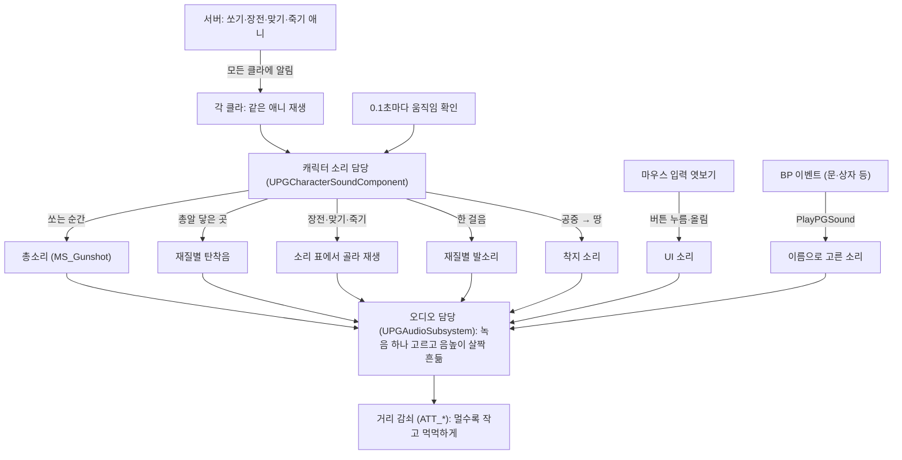

# 게임 소리 (메타사운드)

Wwise 없이 엔진 내장 메타사운드만 쓴다. 팀원 누구나 플러그인 없이 받을 수 있다.

## 누가 무엇을 맡나

- **메타사운드 에셋** (`Content/PG/Audio/MetaSounds`): 녹음을 어떻게 틀지. 합성 소리는 넣지 않고 녹음만 쓴다(총소리 = 가까운/먼 녹음을 거리로 섞기).
- **소리 표 `DA_PGSounds`** (`Content/PG/Audio`): 무엇을 언제 틀지. 총 종류·재질·몽타주 → 소리, 음량, 보폭.
- **C++** (`Audio/`): 사건이 언제·어디서·어떤 재질에서 났는지만 알아내서 넘긴다. 팀원 클래스는 고치지 않는다.
- **BP 자식 `BP_PGCharacterSound`** (선택): `On…` 이벤트를 덮어쓰면 동작을 BP 로 바꿀 수 있다.

## 흐름

말로 된 흐름 (그림과 같은 내용):

- 서버가 총쏘기·장전·맞기·죽기 애니메이션을 틀면 → 모든 클라에 알림이 간다(팀원 코드가 이미 하는 일).
  - 각 클라의 "캐릭터 소리 담당"이 받아서 다음을 한다.
    - 총 쏘는 순간 → 총소리
    - 총알이 닿은 곳 → 재질별 탄착음
    - 장전·맞기·죽기 → 소리 표에서 골라 재생
- 0.1초마다 움직임을 확인한다.
  - 한 걸음 걸었으면 → 발소리
  - 공중에서 땅에 닿았으면 → 착지 소리
  - 이벤트가 아니라 반복 확인인 이유: 걸음은 "끝나는 순간"이 없는 계속 바뀌는 값이고, 엔진이 걸음마다 알려 주지 않는다. 멈춰 있으면 속도만 보고 바로 끝난다.
- 버튼을 누르거나 버튼 위에 올리면 → UI 소리
- 문·상자 같은 BP 이벤트 → "소리 틀기" 노드(`PlayPGSound`)
- 모든 소리는 "오디오 담당"을 거쳐 거리에 따라 작아지고 먹먹해진다. 각 클라의 귀 위치 기준이라 사람마다 다르게 들린다.

## 메타사운드 입력 이름 (C++ 과 맞춰야 함)

- `Wave` (WaveAsset): 가까이서 들리는 녹음. 매번 표의 후보 중 하나.
- `FarWave` (WaveAsset): 멀리서 들리는 녹음(총소리만).
- `Indoor` (Float 0/1): 지붕 아래면 1. 표에서 `bCheckIndoor` 를 켠 소리만 넘긴다. 지금 메타사운드는 이 입력을 안 쓴다(나중에 실내 녹음으로 바꿔 끼울 때 쓸 자리).
- 거리: 메타사운드가 `UE.Attenuation` 인터페이스로 직접 받는다. C++ 은 넘기지 않는다.

## 재질

`Config/DefaultEngine.ini` 의 SurfaceType1~6 = Concrete, Metal, Wood, Dirt, Grass, Flesh 이다.
맞은/밟은 자리 재질은 아래 순서로 정한다(`UPGAudioSubsystem::SurfaceOf`).

1. 물리 재질 `PM_*` 가 붙어 있으면 그것.
2. 캐릭터·몬스터면 Flesh.
3. 지형(랜드스케이프)이면 표의 `LandscapeSurface`(기본 Dirt).
4. 머티리얼·메시·액터 이름에 표 `SurfaceKeywords` 의 글자가 있으면 그 재질. 예: `metal` → Metal, `wood` → Wood.
   맵 메시 대부분은 git 에 없는 서드파티 팩이라 물리 재질을 붙여도 팀원에게 안 간다. 그래서 이름으로 짐작한다.
5. 다 아니면 Default.

짐작이 틀리면 표의 `SurfaceKeywords` 를 고친다(빌드 필요 없음).
`Log LogPGAudio Verbose` 를 켜면 "재질 짐작: '이름들' → 번호" 가 찍혀 어떤 이름이 어떻게 판정됐는지 보인다.

## 팀원 파일에서 소리를 부르는 곳 (한 줄씩, Wwise 브랜치와 같은 자리)

- `UIManagerSubSystem`: 창 열기·닫기 → `UI.Open` / `UI.Close` (아이템 메뉴는 제외)
- `ItemWidget`·`EquipSlot`: 아이템 끌기 시작 → `UI.ItemPick`
- `InventoryGridWidget`·`EquipSlot`: 놓기 성공/실패 → `UI.ItemDrop` / `UI.ItemFail`
- `InteractActor`: 상자 열기 → `Container.Open` (누른 사람에게만 들림. 남도 들으려면 열림 상태 복제가 필요)

## 새 소리 붙이는 법 (C++ 없이)

1. wav 를 `Content/PG/Audio/Waves/<용도>` 에 가져온다.
2. `DA_PGSounds` → `Cues` 에 이름 하나를 추가한다. Sound 는 `MS_OneShot`, Waves 에는 후보를 넣는다.
3. BP 에서 `PlayPGSound(이름, 위치)` 를 부른다. 이 노드는 **모든 클라에서 도는 이벤트**(멀티캐스트·OnRep)에서 불러야 모두에게 들린다.

## 라이선스

- `K_` 는 Kenney(CC0)라 어디든 써도 된다.
- `S_` 는 Sonniss GDC 번들이다. 게임에는 넣을 수 있지만 원본 재배포는 금지다. 공개 저장소에 올릴 때는 빼거나 바꾼다.
